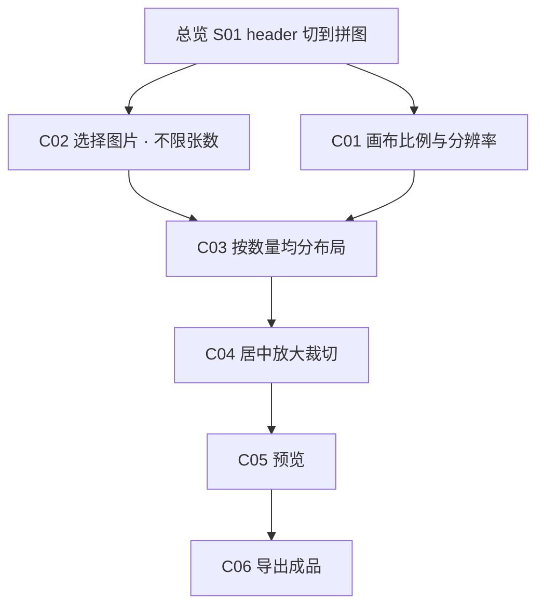

# 拼图 — 功能规格

## 项目概述

拼图是面向社交平台发布的画布排版工具：用户选定 **固定比例的画布**，再按所选图片数量把画布 **均匀切成格子**，每张图在格子里 **居中放大裁切填满**，导出一张没有白边/黑边的成品图。

入口与左侧栏见 [总览](./README.md)：header 切到「拼图」即可，**不走路由**。左侧与 [修图对比](./COMPARE.md) 是同一套添加 / 列表，只是勾选不限制张数；右侧才是拼图画布。

---

## 界面布局

与现有修图对比同一套壳，只换右侧：

| 区域 | 说明 |
|------|------|
| **左侧 · 添加 / 选择图片** | 共用 `items`；勾选 **不限制张数**，顺序即格子顺序 |
| **右侧 · 画布参数** | 比例、分辨率、行列布局 |
| **右侧 · 预览 / 导出** | 实时预览拼图并导出成品 |

---

## 核心规则（必须遵守）

1. **画布比例固定**：先选比例（16:9、4:3、3:2 等），像素宽高始终服从该比例。
2. **分辨率可自定义**：用户改宽度或高度时，另一边按比例算出整数像素。
3. **按图片数量均分格子**：`行 × 列 = 选中图片数`，每个格子尺寸相同，铺满画布、默认无缝隙。
4. **每格 cover 裁切**：图片在格子内居中、等比放大至完全覆盖格子，溢出部分裁掉，格子内不得出现空白（白边/黑边）。

---

## Feature C01 — 画布比例与分辨率

**目标**：画布是一张固定比例的输出图，分辨率可调，但调完仍符合所选比例。

### 预设比例

至少提供以下横向 / 方形 / 纵向常用比例（社交封面、帖子、故事均会用到）：

| 比例 | 典型用途 |
|------|----------|
| 16:9 | 横版封面、视频封面 |
| 4:3 | 传统照片 |
| 3:2 | 相机常用 |
| 1:1 | 方形帖子 |
| 4:5 | 竖版帖子 |
| 3:4 | 竖版照片 |
| 9:16 | 故事 / 短视频封面 |

默认比例建议 **1:1**（社交帖子最常见）；若实现时另有默认，需在 UI 上可一眼看出当前比例。

### 分辨率

- 用户看到并编辑的是 **像素宽 × 像素高**
- 选定比例 `W:H` 后：
  - 改宽度 → `height = round(width * H / W)`
  - 改高度 → `width = round(height * W / H)`
- 宽高必须为正整数；过小或过大时应限制在合理范围（建议最小边 ≥ 256，最大边 ≤ 8192），超出时钳制并按比例重算另一边
- 可提供若干分辨率快捷项（例如 1080 宽、1920 宽），点击后仍按当前比例计算另一边

切换比例时：保持当前 **宽度** 不变，按新比例重算高度（若超出上限则改为钳制后的最大合法尺寸）。

### 预览与输出的关系

- 预览区按画布比例显示，缩放适配窗口（letterbox 只允许出现在 **预览视口周围**，不得出现在画布内部）
- 导出像素 = 用户设定的分辨率，不是预览屏幕上的 CSS 像素

### 验收标准

- [ ] 可切换预设比例，画布预览比例立即变化
- [ ] 只改宽或只改高时，另一边按比例自动更新
- [ ] 自定义分辨率始终满足所选比例（允许 1px 级取整误差）
- [ ] 画布内部无因比例错误产生的空白条

---

## Feature C02 — 选择图片与数量

**目标**：用户导入若干图片，勾选要放进拼图的图片；数量决定可以怎么切格子。

### 功能点

- 添加方式与修图对比一致：文件选择、拖拽、粘贴（同一份 `items`）
- 待选列表展示缩略图与名称，可移除
- 用户勾选 **不限制张数**（与对比的「恰好两张」不同）；勾选顺序 = 从左到右、从上到下的格子顺序
- 1 张即为 1×1 铺满画布；0 张时右侧提示选图，不假装已经拼好
- 张数很多时格子会很小，但不做硬上限（性能与导出分辨率由实现自行兜住即可）

### 验收标准

- [ ] 可一次添加一张或多张图片
- [ ] 可勾选 1 张、4 张以及更多，且对比模式的「满两张替换」在拼图模式下不生效
- [ ] 预览中的格子顺序与勾选顺序一致
- [ ] 未选任何图时，预览为空白画布或明确提示「请选择图片」

---

## Feature C03 — 按数量均分布局

**目标**：画布按选中张数切成等大格子；同一张数若有多种切法，交给用户选。

### 切分规则

画布宽高为 `canvasW × canvasH`，选中 `N` 张图。合法布局为所有正整数：

```
rows × cols = N
每个格子 = (canvasW / cols) × (canvasH / rows)
```

格子从左到右、从上到下排列，无间隙（间距 = 0）。

因画布像素可能无法被 `cols` / `rows` 整除，格子像素允许最后一行/列吃掉余数，但视觉上仍视为均匀分格，不得露出底色缝。

### 同一 N 的多种布局

凡 `rows * cols === N` 的组合都应列出，例如：

| 选中张数 N | 可选布局（行 × 列） |
|------------|---------------------|
| 1 | 1×1 |
| 2 | 1×2、2×1 |
| 3 | 1×3、3×1 |
| 4 | 1×4、2×2、4×1 |
| 6 | 1×6、2×3、3×2、6×1 |
| 8 | 1×8、2×4、4×2、8×1 |
| 9 | 1×9、3×3、9×1 |

用户举例：四张图可选 **2×2** 或 **1×4**（以及对称的 **4×1**）。

### 默认布局

张数变化时，自动选一个「尽量接近方形」的布局：

- 优先 `rows` 与 `cols` 最接近的组合（如 N=4 → 2×2，N=6 → 2×3 或 3×2）
- 若有两个同样接近的，优先 **列数 ≥ 行数** 的横版分格（如 2×3 优于 3×2）

用户手动选过的布局，在 **N 不变** 时应保留；**N 变了** 则按上面规则重选默认。

### 验收标准

- [ ] N 张图对应的每一种 `行×列` 都能选到
- [ ] 四张图至少能选 2×2 与 1×4
- [ ] 切换布局后格子立即重排，图片按原勾选顺序填入
- [ ] 所有格子等分画布，格子之间无底色缝隙

---

## Feature C04 — 格子内居中放大裁切（cover）

**目标**：每张图填满自己的格子，不留白、不留黑，也不拉伸变形。

### 默认算法

对每个格子 `(cellW, cellH)` 与图片原始尺寸 `(imgW, imgH)`（若后续支持图片自身裁剪，则用裁剪后的内容尺寸）：

```
scale = max(cellW / imgW, cellH / imgH)
绘制宽 = imgW * scale
绘制高 = imgH * scale
偏移 x = (cellW - 绘制宽) / 2
偏移 y = (cellH - 绘制高) / 2
```

即 CSS `object-fit: cover` + `object-position: center`：

- 图比格子更「瘦」→ 按高度撑满，左右居中裁掉
- 图比格子更「扁」→ 按宽度撑满，上下居中裁掉
- 比例碰巧相同 → 正好铺满，无裁切

禁止 `contain`（那会留边），禁止非等比拉伸。

### 范围说明（本期不做）

本期 **不要求** 单格内拖动、捏合改裁切中心。默认居中即可。若以后要做「每格微调」，另开规格，不挡本期验收。

### 验收标准

- [ ] 任意比例的源图放入任意格子，格子内无白边、无黑边、无棋盘底
- [ ] 图片不变形（圆被拉成椭圆即不合格）
- [ ] 裁切以画面中心为基准，四周对称裁掉多余部分
- [ ] 预览与导出使用同一套 cover 规则

---

## Feature C05 — 预览

**目标**：改比例、分辨率、选图、布局时，预览实时反映最终拼图。

### 功能点

- 预览画板按当前画布比例适配容器
- 格子线可在预览中淡淡标出（辅助看分格），导出时 **不画格子线**
- 选中图片不足或为 0 时给出提示，不假装已经拼好

### 验收标准

- [ ] 改任何一项参数，预览在同一次交互内更新
- [ ] 预览外的letterbox（视口黑边）不影响对「画布内无边」的判断
- [ ] 辅助格子线仅预览可见

---

## Feature C06 — 导出成品

**目标**：得到一张可直接发社交平台的位图。

### 功能点

- 「导出」生成 **单张图片**（建议 PNG；JPEG 可作为同级选项，质量可固定如 0.92）
- 输出宽高 = 当前设定分辨率
- 内容 = 当前布局 + cover 裁切后的拼图，无水印、无格子辅助线
- 触发浏览器下载，文件名建议带工具名与分辨率，如 `collage-1080x1080.png`

### 验收标准

- [ ] 导出图尺寸与设定分辨率一致
- [ ] 打开导出图，格子内无空白边，图片未拉伸变形
- [ ] 辅助 UI（格子线、手柄）不出现在文件里

---

## 功能依赖关系



---

## 渲染与导出方案（待选定）

本期拼图是「固定格子 + cover 裁切 + 按设定分辨率出 PNG」。下面两个方案都能做，难度差在 **导出是否可靠**，不在预览好不好看。

### 方案 A — Canvas 直接绘制

预览和导出都走 `drawImage`：按格子算 cover 源矩形，画到 `<canvas>` 上；导出时把 canvas 设成目标分辨率再 `toBlob('image/png')`。

项目里 `export-gif.ts` 已经在用同一套 API（加载 `HTMLImageElement`、按裁剪矩形 `drawImage`）。

| | |
|--|--|
| **难度** | **低** |
| 预览 | 中低：要用 `useEffect` 在 state 变化时重画；格子辅助线自己 stroke。不能靠 Tailwind 排格子。 |
| 导出 | **低**：和预览共用一个 `drawCollage(ctx, width, height)`，只是尺寸不同。 |
| 分辨率 | 天然精确：canvas 像素 = 用户设定的 1920×1080。 |
| 风险 | 高分屏预览要乘 `devicePixelRatio`，否则发糊；交互（选中格）得叠一层 HTML。 |
| 工作量体感 | 封面裁切数学约几十行；和现有 GIF 导出同一种心智模型。 |

适合：预览和成品必须同一套像素算法、要自定义分辨率导出。

### 方案 B — HTML → SVG → Canvas → PNG

预览用 React + CSS Grid + `object-fit: cover`（和现有 `CroppedImage` 很像）。导出时把 DOM 序列进 SVG 的 `foreignObject`，再 `drawImage` 到 canvas，最后 `toBlob`。常见库：`html-to-image`（这条链路）、`html2canvas`（改成自己重绘 DOM，不是真 SVG，但产品目标类似）。

| | |
|--|--|
| **难度** | **预览低，导出中高** |
| 预览 | **低**：格子、cover、比例用 CSS 就能看。 |
| 导出 | **高**：`foreignObject` 吃不到 Tailwind 外部样式，blob URL 的 `` 经常空白，Safari 坑多。实务上要把每张图转成 data URL，样式全部 inline。 |
| 分辨率 | 别扭：预览是 CSS 像素，导出要 1920 宽时得克隆节点再缩放，或导出后再拉伸（发糊）。 |
| 风险 | 「预览对了、导出缺图 / 缺样式 / 跨域污染 canvas」是这条链路的经典问题。 |
| 工作量体感 | UI 半天能看；导出稳定往往要再砸 1～2 天打浏览器差异，还可能加依赖。 |

适合：预览以 DOM 为主、导出只要「和屏幕上看着差不多」的截图，且不太在意精确像素尺寸。

### 对照

| 维度 | A Canvas 直绘 | B HTML→SVG→Canvas |
|------|----------------|-------------------|
| 总体难度 | 低 | 中高 |
| 预览实现 | 要手动画 | 最省事 |
| 导出实现 | 最省事、可控 | 最费事、易踩坑 |
| 自定义分辨率 | 直接设 canvas 宽高 | 要额外缩放策略 |
| 与现有代码 | 可复用 GIF 导出的加载 / `drawImage` | 新链路，现有代码帮不上忙 |
| cover 无白边 | 自己算源矩形，结果确定 | CSS cover 预览准，导出是否一致取决于序列化 |

### 建议（尚未开工，等你拍板）

这期需求是 **精确分辨率 + cover 无白边 + 出 PNG**，不是「把网页截一张图」。更稳的是 **方案 A**，或折中：**预览用 HTML/CSS，导出仍用 Canvas 直绘**（预览好看、导出不走 SVG）。不建议把导出押在 HTML→SVG→Canvas 上。

---

## 实现优先级建议

| 优先级 | Feature | 说明 |
|--------|---------|------|
| P0 | C01 画布比例与分辨率 | 画布是后续一切计算的基准 |
| P0 | C02 选择图片 | 数据入口 |
| P0 | C03 均分布局 | 张数 → 格子 |
| P0 | C04 cover 裁切 | 无白边/黑边的核心观感 |
| P0 | C05 预览 | 能看见结果才能调参数 |
| P1 | C06 导出 | 没有导出则无法发社交；实现上可紧跟预览 |

---

## 计算示例

**画布**：比例 16:9，分辨率 1920×1080。  
**选图**：4 张。  
**布局 A — 2×2**：每格 960×540。  
**布局 B — 1×4**（1 行 4 列）：每格 480×1080。  
**布局 C — 4×1**（4 行 1 列）：每格 1920×270。

一张 4000×3000（4:3）的图放进 2×2 的格子 960×540（16:9）：

- `scale = max(960/4000, 540/3000) = max(0.24, 0.18) = 0.24`
- 绘制尺寸 960×720，垂直居中后上下各裁 90px（相对绘制图）
- 格子被完全覆盖

---

## 术语表

| 术语 | 含义 |
|------|------|
| 画布 | 最终输出的那张固定比例位图 |
| 比例 | 画布宽高比，如 16:9，不随分辨率改变 |
| 分辨率 | 画布像素宽高，随比例联动 |
| 布局 | `行 × 列` 的均匀分格方案，且行列乘积等于选中张数 |
| 格子 | 布局切出的一块矩形，放一张图 |
| cover / 居中放大裁切 | 等比放大至铺满格子，居中裁掉溢出，不留边、不拉伸 |
