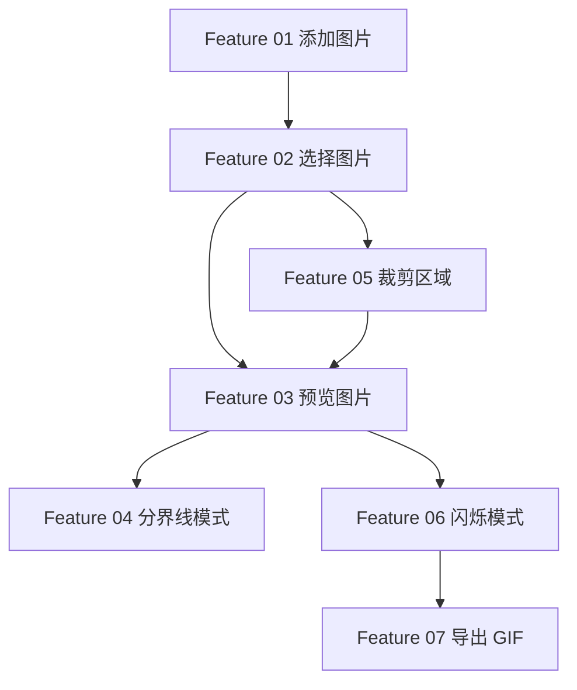

# 修图对比 — 功能规格

## 项目概述

修图对比是一款用于对比两张图片（通常是原图与修图后版本）效果的 Web 工具。核心能力是叠加显示两张图，并通过可交互的方式实时预览差异。

本工具是 header 切换中的默认项。应用总览见 [README.md](./README.md)；拼图见 [COLLAGE.md](./COLLAGE.md)。对比本身仍是「勾选恰好两张」；拼图共用左侧列表，但不沿用这个上限。

---

## 界面布局

界面分为三个区域：

| 区域 | 说明 |
|------|------|
| **添加图片** | 将图片导入待选列表 |
| **选择图片** | 待选列表，从中勾选用于对比的两张图 |
| **预览图片** | 根据已选图片进行对比展示 |

---

## Feature 01 — 添加图片

**目标**：将图片加入待选列表，供后续选择与对比。

### 功能点

- 支持通过文件选择器或拖拽方式添加图片
- 添加后的图片出现在「选择图片」待选列表中
- 支持常见图片格式（PNG、JPEG、WebP 等）

### 验收标准

- [ ] 用户可一次添加一张或多张图片
- [ ] 添加成功后，图片立即出现在待选列表
- [ ] 列表项展示缩略图与文件名（或序号）

---

## Feature 02 — 选择图片

**目标**：从待选列表中指定用于对比的两张图片。

### 功能点

- 待选列表展示所有已添加的图片
- 用户可勾选 **恰好两张** 图片作为对比对象（左/右或前/后版本）
- 选中状态在列表中有明确视觉反馈

### 验收标准

- [ ] 列表支持选中两张图片
- [ ] 选中变化时，预览区响应更新（见 Feature 03）
- [ ] 可取消选中或切换选中项

---

## Feature 03 — 预览图片

**目标**：根据选中的两张图片进行对比预览。

### 功能点

- **已选两张图**：进入对比预览（具体模式见 Feature 04、Feature 06）
- **仅选一张或未选满两张**：预览区不做对比处理，保持空白或提示状态

### 验收标准

- [ ] 选中两张图后，预览区显示对比内容
- [ ] 只选一张图时，预览区不展示对比效果
- [ ] 切换选中图片时，预览实时更新

---

## Feature 04 — 分界线对比模式

**目标**：通过可拖拽分界线，左右（或上下）实时对比两张图。

### 功能点

- 两张图片叠加在同一视图中
- 画面中间有一条可拖拽的分界线
- 拖动分界线时，实时切换两侧显示的图片区域
- 默认对比模式

### 交互细节

- 分界线默认位于视图中央（50%）
- 支持鼠标拖拽；视情况支持触摸拖拽
- 分界线带有拖拽手柄，便于识别

### 验收标准

- [ ] 两张图对齐叠加，分界线两侧分别显示不同版本
- [ ] 拖拽分界线时预览流畅、无闪烁
- [ ] 分界线位置可在 0%–100% 范围内自由移动

---

## Feature 05 — 裁剪区域

**目标**：当修图仅改动局部区域时，可裁剪出关注区域进行对比，避免全图对比带来的干扰。

### 背景

部分修图只修改了画面的某一区域，其余部分与原图一致。此时应聚焦改动区域进行对比。

由于修过的图分辨率可能低于原图，裁剪范围不能仅用像素坐标，需使用 **百分比坐标** 在不同分辨率的图片间映射同一区域。

### 百分比裁剪规则

裁剪区域以图片宽高的百分比表示：

```
crop = {
  x: number,      // 左上角 X，占图片宽度百分比 (0–100)
  y: number,      // 左上角 Y，占图片高度百分比 (0–100)
  width: number,  // 裁剪宽度，占图片宽度百分比 (0–100)
  height: number, // 裁剪高度，占图片高度百分比 (0–100)
}
```

对比时，两张图各自按百分比换算为像素坐标后裁剪，保证对比的是同一相对区域。

**换算示例**：

| 图片 | 尺寸 | 百分比区域 (10%, 20%, 30%, 40%) | 像素区域 |
|------|------|----------------------------------|----------|
| 原图 | 4000×3000 | x=10%, y=20%, w=30%, h=40% | (400, 600, 1200, 1200) |
| 修图 | 2000×1500 | 同上 | (200, 300, 600, 600) |

### 交互流程

```
选中两张图 → 预览区「裁剪区域」按钮 → 进入裁剪模式 → 框选区域 → 确认裁剪 → 同时生成两张裁剪副本 → 自动选中新副本进行对比
```

| 步骤 | 说明 |
|------|------|
| 1. 选中两张图 | 在待选列表中勾选 A、B 两张图片 |
| 2. 裁剪区域按钮 | 预览区工具栏点击「裁剪区域」 |
| 3. 进入裁剪模式 | 预览区进入裁剪交互，可切换 A/B 底图辅助框选 |
| 4. 框选区域 | 拖拽框选关注区域，可拖动边角调整 |
| 5. 确认裁剪 | 同一百分比选区同时应用到 A、B 两张图 |
| 6. 生成裁剪副本 | 产生新的一组（两张）裁剪副本，原图不受影响 |
| 7. 自动对比 | 列表自动选中新副本，预览区展示裁剪后的对比 |

### 功能点

- 一次框选 **同时裁剪两张图**，产出新的一组副本，不破坏原始图片项
- 裁剪模式支持框选、调整选区，可切换 A/B 底图
- 裁剪结果以百分比存储，按各图分辨率换算，保证区域对齐
- 裁剪副本在列表中有标识（名称后缀「(裁剪)」）

### 验收标准

- [ ] 选中两张图后可进入裁剪模式
- [ ] 确认裁剪后同时生成两张新副本，原图不受影响
- [ ] 不同分辨率的两张图，按同一百分比裁剪后区域对齐
- [ ] 裁剪副本自动被选中并进入双图对比预览

---

## Feature 06 — 闪烁对比模式

**目标**：以半秒间隔交替显示两张图，类似 GIF 轮播，更直观地感受修图前后差异。

### 功能点

- 除分界线模式外，提供「闪烁」对比模式
- 每 **500ms** 切换一次显示的图片（图 A ↔ 图 B）
- 两张图需对齐叠加（同一视口、同一缩放）

### 交互细节

- 用户可在「分界线模式」与「闪烁模式」之间切换
- 闪烁模式下可暂停/继续切换（可选增强）
- 切换时图片位置固定，避免画面跳动

### 验收标准

- [ ] 闪烁模式每 0.5 秒切换一次图片
- [ ] 两张图切换时位置对齐，无明显位移
- [ ] 可在两种对比模式间自由切换

---

## Feature 07 — 导出 GIF

**目标**：将闪烁对比效果导出为 GIF 文件，便于分享或存档。

### 功能点

- 在闪烁对比模式下提供「导出 GIF」操作
- 生成的 GIF 复现预览中的交替效果（500ms 间隔）
- 若存在裁剪区域，导出内容应与当前预览一致（裁剪后的视图）

### 技术要点

- 帧率：2 fps（每帧 500ms）
- 至少包含两个完整循环（建议可配置帧数或循环次数）
- 输出为标准 GIF 文件并触发浏览器下载

### 验收标准

- [ ] 闪烁模式下可点击导出 GIF
- [ ] 导出的 GIF 交替效果与预览一致
- [ ] 导出文件可正常打开播放
- [ ] 有裁剪时，GIF 内容为裁剪后的对比区域

---

## 功能依赖关系



---

## 实现优先级建议

| 优先级 | Feature | 说明 |
|--------|---------|------|
| P0 | 01 添加图片 | 基础数据入口 |
| P0 | 02 选择图片 | 对比前置条件 |
| P0 | 03 预览图片 | 核心展示逻辑 |
| P0 | 04 分界线模式 | 核心对比交互 |
| P1 | 05 裁剪区域 | 局部对比增强 |
| P1 | 06 闪烁模式 | 第二种对比方式 |
| P2 | 07 导出 GIF | 分享与存档 |

---

## 术语表

| 术语 | 含义 |
|------|------|
| 待选列表 | 已添加、尚未用于对比或正在参与选择的图片集合 |
| 副本 | 基于列表项复制的新项，用于裁剪等不破坏原图的操作 |
| 裁剪副本 | 经裁剪后生成的新列表项，携带百分比裁剪信息 |
| 百分比坐标 | 以图片宽高百分比表示的区域，用于跨分辨率对齐 |
| 分界线模式 | 拖拽中线左右对比的默认模式 |
| 闪烁模式 | 定时交替显示两张图的对比模式 |
